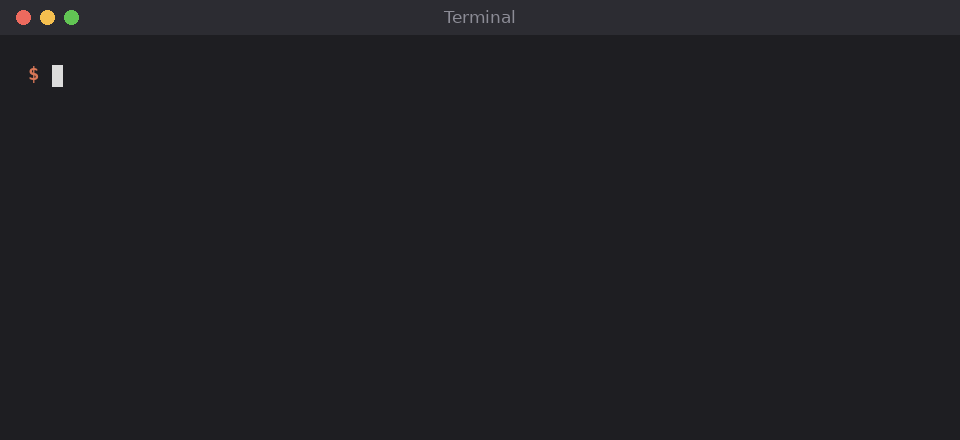

# claude-chrome-autostart

A Claude Code plugin that opens Chrome when Claude needs the browser.

Without it, when Chrome is closed, every `claude-in-chrome` tool fails with "Browser extension is not connected" and you have to open Chrome yourself and ask again. With it, Claude opens Chrome, waits for the Claude extension to connect, and the tool call goes through.



<sub>Re-created from a real run. With Chrome closed, the call took about 14 seconds to open Chrome, connect and load the page. The wait is sped up in the GIF.</sub>

## Install

```
claude plugin marketplace add kbrianps/claude-chrome-autostart
claude plugin install chrome-autostart@claude-chrome-autostart
```

Then start a new session, or run `/reload-plugins`.

## How it works

A `PreToolUse` hook runs before any `mcp__claude-in-chrome__*` tool:

1. If the extension is already connected, it exits right away (about 10 ms).
2. If Chrome is not running, it starts it.
3. It waits until the extension connects, for at most 20 seconds, then lets the tool run.

The extension counts as connected when its native host has a live socket in `/tmp/claude-mcp-browser-bridge-$USER/`.

The whole hook is [`plugins/chrome-autostart/hooks/ensure-chrome.sh`](plugins/chrome-autostart/hooks/ensure-chrome.sh), about 50 lines. It makes no network calls and writes no files.

## Settings

Environment variables, which you can set in the `env` block of `~/.claude/settings.json`:

| Variable | Default | |
|---|---|---|
| `CHROME_AUTOSTART_CMD` | first found of `google-chrome`, `google-chrome-stable`, `chromium`, `chromium-browser` | command that opens Chrome |
| `CHROME_AUTOSTART_TIMEOUT` | `20` | seconds to wait for the extension |

## Requirements and limits

- Linux. Tested on Ubuntu with GNOME on Wayland and Google Chrome. macOS and Windows are not supported.
- The Claude extension must already be installed and signed in.
- Chrome opens with its usual startup window (your restored tabs, or an empty tab). The extension then opens its own window for Claude. Starting Chrome with no window (`--no-startup-window`) only works if "Continue running background apps when Google Chrome is closed" is on, so the plugin does not do it.
- If Chrome is open but the extension is disconnected, the plugin waits for it but cannot reconnect it. Use `/chrome` for that.
